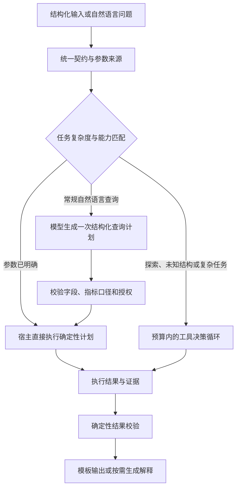

# AgentForge 实验解读与改进建议

状态补充：本文关于强制自定义工具、逐步调度等分析针对历史实验产物。当前代码已经调整路由，并新增业务契约、规范化、精确指标、只读 SQL 和数据绑定；详见 [实现说明](docs/agent-quality-contracts.md)。新代码尚未测试或评测，本文历史实验数字不能用于证明新路径的效果。

审阅日期：2026-10-12。范围：v0.12 源码、CSV 对照协议与脚本、精简原始证据、v0.11/v0.12 验证报告，以及实际生成的 v1 工具。本文是代码与证据审阅，没有新增真实模型实验；建议的效果尚待验证。

## 1. 实验支持什么结论

**在已测的小规模 CSV 场景里，目前的生成 Agent 没有表现出正确率优势，却增加了答题耗时和构建成本。现有证据不足以证明“制作 Agent 普遍不如直接 Codex”，也不足以判断开放式数据库问答。**

| 指标 | 直接结构化 Codex 回答 | 工厂生成 Agent |
| --- | ---: | ---: |
| 首次十二题交付 | 12/12 | 3/12，另有两题调用失败、七题未执行 |
| 同一新窗口的九题补充对照 | 9/9 | 9/9 |
| 九题模型请求数 | 9 | 21 |
| 九题答题累计耗时 | 4.78 分钟 | 15.60 分钟 |
| 一次性构建 | 无 | 16.20 分钟、60 次请求 |

以上来自 [CSV 对照报告](docs/csv-comparison-v1.md) 与 [原始精简证据](docs/csv-comparison-v1.json)。九题补充对照中，七道计算题两边均正确；两道非法输入题由生成 Agent 的宿主直接拒绝，不调用模型。不能把累计覆盖 12/12 写成首次成功，也不能把未执行题解释为计算错误。

比较对象有明确边界：[实验脚本](experiments/run_csv_comparison.py) 的直接组每题给出全部 24 行数据，要求一次结构化回答，没有开放计算工具工作流。它不是完整 Codex 使用 Python、文件、SQL 等能力的最佳基线。后端具体模型身份未暴露，只有相同 CLI 与请求配置；并发和服务状态影响耗时。一个账本和一个有效构建不能估计广泛泛化能力。

[v0.11 报告](docs/verification-v0.11.md) 中，两个历史 CSV 任务内部验收、导出成功后，独立问题分别只通过 4/6 和 5/6。这说明“内部通过”不能替代独立业务验证。[v0.12](docs/verification-v0.12.md) 已修复参数来源和 count 元数据等已知问题，但修复验证是确定性回归，不能声称新的真实交付率已经提升。

数据库方面，`contracts.py` 的任务类型只有 document_qa 与 csv_analysis。`trusted_tools.py` 执行运维固定配置的 SQL，模型只能提供绑定参数。它是已有查询的自然语言入口，尚不是完整的开放式 Text-to-SQL 系统；当前 CSV 对照不能推出数据库问答结论。

## 2. 为什么当前设计难以取得优势

### 2.1 强制生成工具，制造了与问题无关的工作

`adaptive_planner.py` 的设计 Schema 至少要求一个自定义工具，提示词要求至少一个 required=true；`AdaptiveSpec.validate` 再次强制检查；`adaptive_runtime.py` 完成前要求它已成功执行。

实际产物生成的是 `custom.numeric_value_profile`，每个合法问题都执行全局质量检查，然后调用已有的 csv.query。即使用户只是数 pending 行，也执行数值列质量检查。工具本身有意义，但其必要性应由任务依赖决定。内置查询已经足够时，工厂应允许零新增工具。

### 2.2 运行时把确定性步骤交给模型逐个调度

运行提示要求每轮只选一个工具。本次合法题都是质量工具、查询、最终回答三次模型请求。模型负责已经可由宿主明确安排的步骤，既增加时延，也扩大服务失败的暴露面。

已有缓存只复用同一次执行中的部分内置工具观察，生成工具与可信实时工具不缓存。它没有解决同一冻结数据集跨问题重复做质量检查的问题。

### 2.3 格式验证没有消除语义契约矛盾

原始证据中的生成指令称 limit=0 合法；开发用例的 criterion 也要求合法空结果，但机器 expected 是 INVALID_INPUT，宿主拒绝后用例通过。因此该用例没有执行其声称验证的均值计算。

“39/39 内部通过”只表示已有机器断言通过，不代表设计、测试说明与宿主语义一致。JSON Schema 能约束形状，不能自动发现业务规则互相矛盾。

### 2.4 能力范围小于一般数据分析智能体

目前 CSV 查询主要是单表筛选、单列聚合、单列分组、排序和截断。导入保留字符串，数值转换使用 float；每个数据集最多 20000 行，自定义工具受 AST 与解释步数限制。这些边界与 24 行示例兼容，但没有覆盖多表连接、时间窗口、去重、透视、精确金额、脏数据清洗或大型 CSV。

生成代码只能使用严格 Python 子集。这是已有执行边界；应通过受控的成熟数据工具扩展能力，避免让模型为常见运算重写受限版本。

### 2.5 复用单位更接近“固定数据快照”

本次自定义源码绑定具体 dataset_id 和列列表，产物与资源快照一起冻结。它适合审计这份账本，但新账本不一定能直接复用。若每份相似账本都重新生成源码和做完整模型验收，构建成本很难摊薄。

## 3. 建议的目标架构

让工厂产出以下可复用资产：业务语义契约、字段与指标映射、授权资源绑定、执行计划、必要的扩展工具和验收证据。根据任务选择运行方式，不强制所有任务进入自由工具循环。

预期目标：结构化查询零次模型请求；常规自然语言查询一次计划请求，确需解释时再增加一次。复杂任务保留决策循环。以上是待测试目标，不是已测性能。

## 4. 改进顺序和验收条件

### P0：先修生成与验收机制

**允许零自定义工具。** 同时调整设计/代码 Schema、AdaptiveSpec、生成提示、工具覆盖检查、完成条件与导出验证。不要只改 required 的一处判断。改为“先复用可信能力，仅为缺失的业务计算生成扩展”；必须执行的步骤由具体计划和业务契约声明。

**建立单一可执行契约。** 把 operation、limit 边界、空值、计数、排序并列处理、参数优先级、错误码、结果结构做成版本化定义；生成器、参数校验、运行时、结果格式与评测从它派生。模型只生成业务映射与扩展规则，不重复发明通用宿主规则。保留 v0.12 的 user/default/human_reply 来源标记。

**用结构化语义字段代替规则散落在文本中。** 例如指标定义、有效输入范围、空值政策、预期执行层和断言类型。冻结前确定性检查：声明合法的计算输入能否通过宿主、计算用例是否真的执行计算、负例是否与错误层一致。文本指令从这些字段生成；剩余自由文本可做辅助审阅，但不能把模型审阅当作证明。

**独立验证自然语言到查询的映射。** Decimal oracle 能验证给定查询的计算；若自然语言目标与参考查询均由生成器产生，二者可能共享同一误解。另设人工维护的目标/查询对和未见任务集，内部生成测试仅作开发证据。

验收：原有边界回归继续通过；增加“无需扩展工具”的生成场景；像 limit=0 的设计矛盾在冻结前被拒绝；已知自然语言参数覆盖问题在新真实盲测中复验。

### P1：减少调度开销，形成业务专长

**增加 direct_plan / single_plan / adaptive_loop 三种运行策略。** 对明确结构化输入直接执行 csv.query；常规自然语言先生成 typed QuerySpec，再由宿主执行。允许一个计划安排多个独立工具，依赖步骤仍按依赖顺序执行。已有 planner/workflow 代码可作确定性执行的起点，但需核对其契约与当前运行时是否一致。

**把质量检查移到资源接入或数据变更时。** 冻结 CSV 可按资源内容指纹、列、检查算法/工具版本、参数及租户权限复用结果。生成工具只有在纯函数且依赖明确时才能缓存；依赖 observation 的工具需包括依赖指纹。实时数据库结果默认不跨请求缓存，除非绑定一致快照或明确允许的时效策略。

**建设业务语义层。** 明确净额是否含退款、待处理记录是否排除、订单数按行还是去重主键、时间按哪个时区、金额和单位精度、连接键与连接基数。模型规划前读取这些规则，宿主执行时校验。领域知识带来的改善可单独评测：同信息基线用于比较架构，另一个现实基线用于比较完整产品价值。

**复用任务模板，区分能力与数据。** Agent 版本绑定 schema/业务契约/工具能力；数据版本绑定具体授权快照与 profile。新数据先做兼容性验证再绑定。不能静默改变历史产物的冻结资源；需要保留旧版本及新的数据绑定审计。

**压缩模型上下文。** 保留 schema、字段含义、相关枚举、必要样本和有效观察；传摘要与引用而非每轮累积全部大结果。对工具错误只提供可修正的信息。记录 token 用量、缓存用量和每阶段耗时；模型请求数本身不等于货币成本或隐藏推理次数。

验收：常规题模型请求从观测到的三次降至目标的一至两次，结构化题目标零次；在独立正确率不降低的前提下比较延迟和 token 用量。缓存命中与数据变化后的失效分别验证。

### P2：扩大真实数据处理与数据库能力

**规范化数据并保留原始值。** 定义编码、分隔符、列名映射、类型、缺失值、日期时区、金额精度与单位；保留转换日志、失败行和原始字段。不能把非法数值自动替换为零。标识符 00123 要作为字符串保留；计行数与计非空值分别定义。模式可推断，但推断结果应验证并形成明确类型契约。

可评估 DuckDB 等成熟受控执行器：其 CSV 读取支持方言/类型探测以及显式类型覆盖，适合作为接入层候选；自动推断不能替代业务类型契约。[DuckDB 官方 CSV 文档](https://duckdb.org/docs/current/data/csv/auto_detection)

**增加真正的数据库问答任务类型。** 提供 schema、主外键、列注释、枚举值/有限样本、指标定义和可用关联路径；模型生成结构化查询计划，再编译到 SQL。确需生成 SQL 时，使用解析树检查与数据库权限、资源预算共同约束，保留当前参数绑定和只读边界。复杂查询需要检查 join 是否导致重复累计、NULL 语义、COUNT(*) 与 COUNT(column)、日期范围、去重和分母口径。

**检验语义而非只检验“执行成功”。** 为 SQL 准备多个反例数据库：一对多连接、重复订单、空值、无匹配行、跨日边界。同一个错误查询可能在单一数据库上碰巧返回正确结果；Text-to-SQL 的 test-suite evaluation 专门讨论了这个问题。[EMNLP 原始论文](https://aclanthology.org/2020.emnlp-main.29/)

**将解释绑定到计算事实。** 当前结构化数据评分没有覆盖每句自然语言解释。最终答案可先生成 claim→指标/观察引用列表，核对数值、筛选口径、单位与比较范围后再渲染。无法充分验证的因果解释不应从简单相关统计自动产生。

**保留预算内升级路径。** 不支持的查询、不可恢复的解释器能力限制或无进展时，转入能力更完整的受控执行路径；避免在错误边界里反复修补。将升级、失败和人工澄清计入完整指标，明确它们分别贡献了多少成功。

## 5. 如何确认下一版真的更好

建议同时比较：A 现有一次结构化回答；B 可使用 Python/SQL 的完整 Codex 基线；C 旧工厂 Agent；D 改进后的 Agent。各组获得相同业务知识、数据权限与总预算；构建预算另外列出。模型身份尽量固定且记录，无法确认时明确未知。

按业务/schema/数据集拆分开发和隐藏测试，不只换同一账本的提问。覆盖小表、大表、脏数据、多文件、连接、复杂指标、歧义、未支持需求与资源漂移。每个任务独立构建多次，并重复运行问题，衡量生成产物的稳定性；共享额度情况下随机交错各组执行顺序并限制并发。

分别报告：首次交付率、全部分配任务的成功率、已执行题正确率、未执行/服务失败/语义失败/计算失败/契约失败、构建成本、每题请求与 token、p50/p95 延迟、人工介入和解释事实正确率。至少给配对差异及不确定性区间。恢复成功单列，不能覆盖首次失败。

做消融：取消强制扩展工具、快速路径、契约统一、profile 缓存、业务语义层、扩展执行器分别比较。开发集用于选择候选，保留验收只负责放行，最后的隐藏测试不回流修复；修复后需要新的隐藏任务评估泛化。

复用经济性可写为 C_build + N × C_agent 与 N × C_direct 的比较。只有 C_agent < C_direct 时，单看该成本指标才存在 N > C_build / (C_direct − C_agent) 的回本点。按当前窗口观测的耗时与请求数，Agent 的每题开销更大，增加复用次数不能自动带来这两项指标的优势。权限、审计和打包的产品价值应单独评价。

## 6. 推荐先做的版本

先交付“零扩展工具可生成 + 单一契约 + 常规查询快速路径 + 资源级质量检查复用 + 新隐藏 CSV/SQL 基准”。保留已实现的冻结验收、独立 Decimal oracle、错误分层、恢复记录和版本指纹。

这个方向的优势来源应当可测量：更准确的业务口径、更少的模型调度、更可靠的计算、更广的必要能力和更强的跨数据复用。仅仅生成更多工具、增加提示词或多跑自生成测试，没有现有证据表明能超过直接 Codex。
