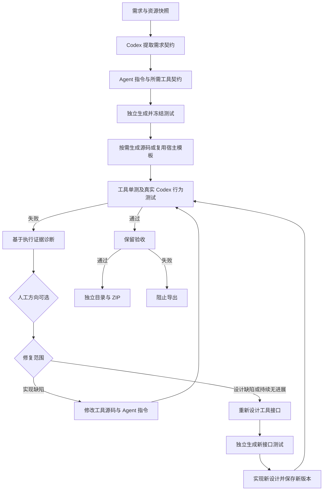
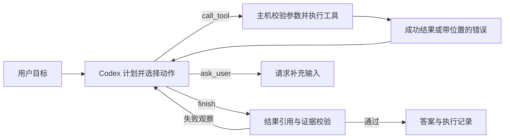

# 架构与执行边界

当前源码包含共享 CSV 契约、零自定义工具生成、查询分流、资源档案缓存，以及规范化、指标、SQL 和数据绑定模块。详见 [业务契约说明](agent-quality-contracts.md) 与 [路由说明](structural-query-routing.md)。已完成 [第 1 阶段架构验证](phase1-architecture-validation.md)；真实模型的新架构评测仍待开展。

工厂遵守固定的构建验收顺序；子 Agent 根据输入和所需能力选择直接计算、单次查询规划或决策循环。

## 三个执行层

1. **Codex 层**：构建时设计需求、指令、工具、场景、源码和修复；运行时根据已有观察生成计划、选择工具、调整参数并决定完成或请求输入。使用严格 JSON Schema，无离线回退。CLI 返回结构化内容，主机负责执行工具。
2. **受信工具层**：resources.list、documents.read、documents.search、csv.preview、csv.query、csv.profile、csv.metrics、csv.sql 操作授权快照。文档分页读取每次最多 10000 字符，语义理解由运行时 Codex 完成。CSV 基础查询有独立数值 oracle；指标使用冻结业务口径和 Decimal。
3. **生成代码层**：按需生成的 custom_tools/*.py 实现业务计算，logic.py 整理最终答案；源码通过 AST 解释器运行，不对不可信源码调用 exec/eval。符合条件的零扩展 CSV 产物使用 observed-v1 宿主输出模板。

Python 子集支持变量、列表/字典、下标、条件、有限集合循环、返回、基本算术与比较。辅助函数在 program.py 的 HELPERS 中声明。禁止 import、属性、方法、反射、推导式、while、文件、网络和进程。限制源码长度、AST 数量、解释步数与中间数据大小；资源工具另有文件、行、列及分组数量预算。

自定义工具允许 0–3 个，正常回答要求已声明的必需工具成功执行。核对 resources.list 后明确拒答域外文档问题、且不引用来源或数据的路径可免执行业务工具。每个工具有描述、命名参数、输出 Schema 和真实 def run(context) 源码。工具可使用 dataset(id)、document(id)、observation(id) 获取授权资源或先前观察的副本，实现数据质量、占比、对比等纯数据计算。参数和输出定义在源码生成前冻结；代码修复不能改写接口，设计修复可在新版本中重设接口，但不能更改原业务场景。

自定义工具限制为 200000 解释步、600000 字符数据和 20000 项集合；源码最多 16000 字符、AST 最多 2500 节点。导入成功的大文件仍可能触发计算预算，需要拆分任务或扩展受信能力。输出代码只能修改 answer，不能篡改 data、sources、abstained 和 error。来源和数值校验不能证明所有解释都正确。

## 运行时决策

复杂任务使用以下决策循环；常规 CSV 查询的直接执行和单次规划见 [三种执行路径](../README.md#三种执行路径)。

每段决策目标为 3–16 次，通常设计为 6–8 次；启用自适应模式时，有新成功结果可最多延长两次，累计决策上限仍为 max_steps × 3。完成条件明确包含缺失必需工具、合规结果引用和最近校验错误。内置快照工具重复请求复用成功观察；自定义和实时可信工具不缓存。相同工具与参数重复超过两次会收到 TOOL_REPEAT；预算耗尽返回 AGENT_BUDGET，缺少输入返回 NEEDS_INPUT。认证、网络或额度错误返回 MODEL_ERROR，无替代结果。计划与简短理由进入记录，不要求内部思维过程。

响应包含 answer/data/sources/abstained/error、trace、observations、model_calls、elapsed_ms。结构化 CSV 基础输入的 data 必须引用按相同参数执行的 csv.query 观察；metric_query 输入则核对对应的 csv.metrics 观察。自然语言目标可使用查询、SQL、已授权可信工具或自定义计算，预览、质量档案和数据库结构不能代替最终计算结果。文档引用必须在实际读取的片段中出现且能回查原文。主机保留完整工具结果，过大的模型可见观察会截断并标记。

## 验收隔离

测试先于源码生成，冻结基础需求、工具样例和自然语言目标三类场景。先运行本地工具单测，失败则跳过模型行为测试；通过后使用真实 Codex 并行执行行为场景（最多 3 个）。代码生成和修复只看开发分区，不接触保留验收。CSV 主查询由独立 Decimal oracle 核对，不复用生产聚合函数。工具预期由模型在看到源码前单独生成，能发现实现偏差，但不是复杂业务算法的正确性证明。

资源、需求、工具定义和测试发生变化时拒绝续跑。指令、源码及运行时指纹绑定当前报告；custom_tools 文件与 agent.json 源码交叉校验。每次修复保留工具源码差异。构建期间运行时变化会阻止测试或导出；已完成任务通过独立模块命名空间加载并校验原导出运行时，未完成任务可用 upgrade-runtime 生成新版本后重跑验收。保留失败结束本轮且不导出，不改写既有失败记录。

这些指纹用于发现意外改动与错用版本，不是对能修改整个工作区的人提供防篡改密码学证明。

## 持久化与并发

SQLite 是任务状态的读取来源；state.json 为可审阅镜像。revision 防止旧状态覆盖新状态，跨进程租约防止同一任务同时执行。每个版本写入独立目录，源码不会被修复覆盖。阶段完成后保存检查点，模型失败可从当前阶段 retry。

本机服务器有独立构建和子 Agent 运行队列。POST /api/jobs/<id>/run 返回 202 和 execution_id，GET /api/jobs/<id>/executions/<execution_id> 可读取实时状态与 trace。执行记录保存输入、版本、产物指纹和结果；排队期间版本变化会拒绝运行。重启后有检查点的执行标为 interrupted，显式 continue 才恢复；无检查点的历史执行仍标为失败。不会自动重放消耗额度的调用。构建调用失败从保存阶段 retry；运行时模型中断保留 *_interrupted.json，不当作源码缺陷修复。

新导出包运行需要已登录 Codex。verify_agent.py 默认检查完整性及本地工具单测；--live 才重新执行模型行为验收并消耗额度。构建时的行为证据保存在 evaluation.json。

服务器仅绑定 loopback，对 Host/Origin 与 JSON 写入请求做校验；不接受任意资源路径或任意文件下载。当前没有多用户身份、授权或部署隔离，适用于单机工作区。

## v0.5 增量

独立评测集位于 benchmarks/unseen_v1.json，既不调用测试生成模型，也不读取生成器的测试作为正确性依据。benchmarking.py 只把需求和文件送入工厂；完成后才把单条问题送给冻结 Agent，手写答案留在判分器。报告与原验收独立保存，不改变完成状态，也不反馈给自动修复。固定公开用例会随使用产生污染，需要定期引入新的人工维护任务。

子 Agent 检查点绑定 spec、源码、资源、需求和初始输入，执行记录再绑定版本与 artifact_hash。每次模型请求前、决策提交后、工具观察提交后均保存 phase/pending/trace/observations/replies/calls。进程中断不会遗忘已提交结果；未提交模型请求计入调用数，未提交只读请求可能重读。OS 文件锁阻止两个进程同时恢复同一执行。等待输入可附文字及经过原 CSV 输入校验的参数，最多 5 次；累计决策最多 max_steps 的 3 倍，不能通过接续重置。

可信工具是运维配置的只读能力，不是生成代码的新权限。设计只能选择已配置 ID，固定绑定参与版本指纹；主机执行参数化 SQL 或固定 GET，校验输入输出，记录绑定及结果指纹。SQLite 限定表、路径、只读模式与进度预算；HTTP 禁止重定向，认证引用环境变量，限制返回大小。数据库和服务数据是实时读取，不能当作冻结资源；完整定义和部署步骤见 tool-integrations.md。

版本目录同时保留 runtime/ 可信源码及 runtime_manifest.json。主机升级后，完成版本优先校验原导出运行时；未完成的新版本也可校验并加载其源码快照，延续已有执行。旧任务只有指纹而没有源码快照时，仍需 upgrade-runtime 生成新版本验收。CSV 决策 Schema 将文档 sources 限制为空，并动态提供已执行且符合结构化参数的观察 ID，避免工具 ID/数据集 ID 被误用为最终结果引用。

## v0.6 设计修复与耗时

诊断提供 repair_scope=code/design。工厂在设计缺陷或连续修复没有提升开发通过率时进入 redesign、redesign_tests、redesign_code。新接口和测试保存在 designs/dN，原 root test_suite.json 与 tool_contracts.json 不覆盖；state.active_design 指向当前设计。原 cases 和 goal_cases（含开发及保留验收）逐项保持相同；接口不变的工具复用原单测，接口变化的工具在看到新源码前生成新单测。新版需重新通过全部开发与保留验收，验收失败仍结束本轮。版本快照同时保存适用的 test_suite 和 tool_contracts；导出包带原 business_suite 与设计历史。

performance 保存构建累计耗时上限、运行默认上限和已用时间。CodexClient.deadline 将总剩余时间与单次超时取较小值；不设 token 配额。时间耗尽保存 time_limit 状态，重试可增加累计时间或设为 0。子 Agent 的 TASK_TIMEOUT 保留决策检查点，可调整时间接续；人工等待不计入主动运行时间。构建租约每 30 秒续期，避免长测试阶段超过租约。

新独立集 unseen_v2 包含两项新合成业务及 14 个问题；benchmark --suite 可选择评测集，每次报告保存整套评测快照与耗时/调用记录。隐藏问答在新构建之前冻结，不反馈到本轮生成与修复。
