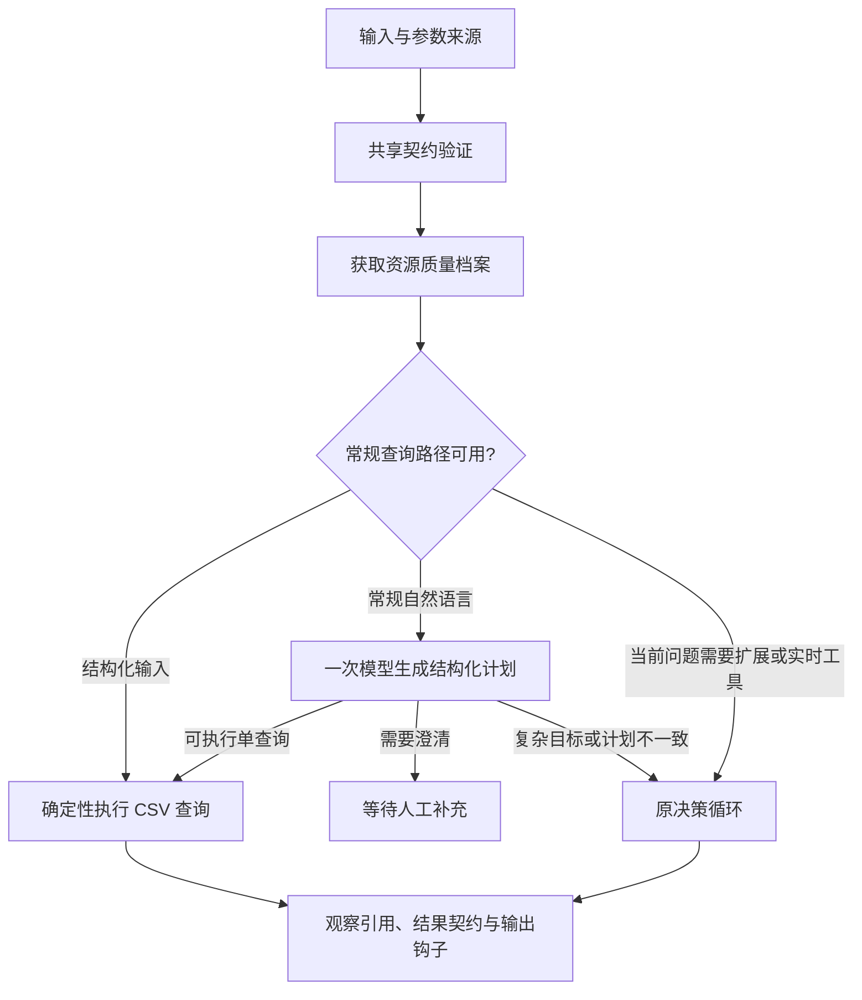

# CSV 生成与运行链路的结构调整

后续修改见 [业务契约、执行能力与数据复用](agent-quality-contracts.md)：新增规范化、业务指标、关系查询和显式快照绑定。

初次调整时按要求未运行测试；后续已完成 [第 1 阶段架构验证](phase1-architecture-validation.md)，覆盖三种路径各 5 个样例及恢复边界。使用模拟模型响应验证宿主行为，尚未执行真实模型隐藏任务评测，不代表已测模型性能或交付率。

## 生成器

允许 `custom_tools=[]` 和 `custom_sources=[]`。需求与设计阶段先复用内置能力，只为用户需要、且已有能力缺少的计算生成工具；不再为每个任务强制增加一个必需的自定义工具。生成、修复、接口样例和导出入口均接受空工具列表。

零自定义工具的本地工具验证标为不适用，仍保留原有行为验收入口；不将空工具集合描述为通过了真实模型业务验收。后续验证已覆盖真实生成器、行为验收及独立运行包，并确认无需生成冗余输出源码。

## 共享可执行契约

`csv_contract.py` 是 CSV 操作、参数字段、筛选运算符、条数边界、count 归一和结果结构的定义来源。需求默认值、运行时输入、查询工具、确定性 DAG 输入和最终 CSV 结果共用这份契约。模型可见目录、结构化查询计划和生成指令也从它派生。

`csv-query-v1` 保持 `limit=null` 或整数 1..1000，拒绝 0 和布尔值；count 统计筛选后的完整行，包括空数值行，结果 `column=null`。数值聚合忽略 null/空字符串；空 sum=0，空 mean/min/max=null。用户/人工显式参数优先于目标推断和默认值，显式 []、false、null 不会被当作未提供。

统一契约约束机器执行和结构化字段，不能自动证明任意自由文本说明或自然语言推断正确。独立 Decimal oracle 保留独立计算实现，没有改为调用生产聚合函数。

## 查询分流

新 CSV 构建保存：

```json
{
  "csv_strategy": "auto",
  "resource_profile": true,
  "csv_contract_version": "csv-query-v1"
}
```

其他已有预算字段继续保留。`csv_strategy=loop` 可保留逐步决策方式。



快速路径用于声明 csv.query 且没有必需自定义步骤的 CSV Agent；可选工具和可信工具的存在不再直接禁用它。规划器看到可用能力，当前问题需要扩展或实时工具时返回循环。常规自然语言计划可返回 execute、metrics、ask_user 或 defer；查询计划通过授权、参数和显式输入校验后才执行。业务指标从冻结的数据契约选择，不能擅自更改公式或固定筛选条件。

结构化路径不请求模型；自然语言单查询只请求计划，最终数字取自工具观察，答案通过已有输出钩子整理。复杂目标或可修正的计划问题回到原循环，模型服务失败继续返回原有错误和可恢复检查点，不使用伪造结果兜底。

计划提交、查询观察提交、等待输入和中断继续保存在检查点中；新的路径也计入累计模型调用预算。宿主完成已提交的查询不额外消耗模型决策。复杂路径的性能可能包含一次分流请求的额外成本，尚未测量。

## 资源质量档案

宿主提供 `csv.profile`，统计完整 CSV 快照的行数，以及每列的空值、可转为有限数值和非数值单元格数量。它是数据质量证据，不把文本列判定为错误，也不改变 count 或查询的空值语义。

缓存位于工作区 `.agentforge/resource_profiles/`，按授权资源内容、契约版本、档案版本及相关实现源码哈希绑定。读取后校验缓存绑定和结果哈希；数据或实现变化产生新的缓存键，损坏记录会重算。缓存读取/写入失败时可继续计算，写入失败进入审计记录。

同一运行器内使用内存缓存和锁，不同运行器可复用工作区磁盘缓存。审核信息使用线程局部存储，包含命中类型、资源哈希、算法哈希和耗时；检查受运行截止时间约束。该缓存仅适用于确定性资源档案，不扩展到生成工具、HTTP 或实时数据库结果。

## 冻结与导出

新增模块纳入运行时快照和独立运行包。新构建的工具契约记录 CSV 语义定义，执行策略参与产物指纹。构建预算不会覆盖生成器选择的路由与档案策略。

旧冻结产物使用自己的运行时快照；没有新执行策略的配置默认使用循环。新路径不会自动改写历史产物、既有验收结果或历史对照报告。工作台与导出说明显示新的运行方式。

## 当前交付状态

已补齐模块与端到端测试、修复回归并复跑完整旧测试。实际路由、调用计数和源码指纹见 [验证结果](verification/phase1-architecture-results.json)。尚无真实模型调用或新隐藏任务结果，不能据此宣称模型准确率或速度已提升。
